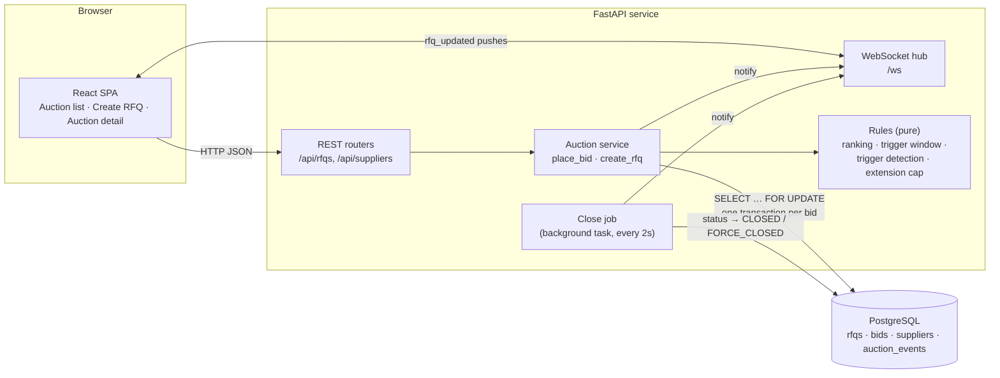
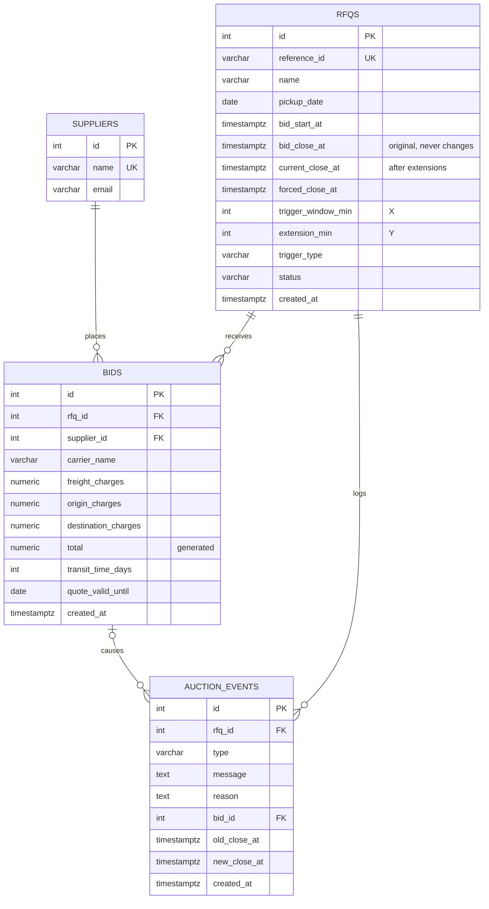

# British Auction RFQ System

A simplified RFQ (Request for Quotation) platform where suppliers compete in a **British auction**: they bid openly, keep undercutting each other, the auction auto-extends when there's late activity, and a **forced close** time stops it no matter what.

- **Backend:** FastAPI · SQLAlchemy 2 (async) · PostgreSQL · WebSockets
- **Frontend:** React 18 · TypeScript · Vite
- **Infra:** Docker Compose (Postgres + API + web)

---

## Quick start

### Everything in Docker
```bash
docker compose up --build
```
Then seed demo data (4 suppliers + 3 short live auctions):
```bash
docker compose exec api python -m app.seed
```
Open http://localhost:5173. API docs: http://localhost:8000/docs.

### Local dev (Postgres in Docker, app on the host)
```bash
docker compose up -d db
cd backend
python -m venv .venv && .venv/Scripts/activate      # macOS/Linux: source .venv/bin/activate
pip install -r requirements.txt
cp .env.example .env
python -m app.seed
uvicorn app.main:app --reload
```
```bash
cd frontend
npm install
npm run dev
```

### Tests
```bash
cd backend
pytest
```
`tests/test_rules.py` covers the pure auction rules and needs no database. `tests/test_place_bid.py` runs the full bid flow against Postgres (row locks, generated columns, concurrency) and is skipped unless `TEST_DATABASE_URL` is set (it is in `.env.example`).

---

## High-level design



### Components
| Component | Responsibility |
|---|---|
| **React SPA** | Three pages. A shared WebSocket tells pages when an RFQ changed; they then refetch over REST. Countdown uses the server clock (`server_time`) to avoid client clock skew. |
| **REST API** | Create/list/get RFQs, submit bids, list suppliers. Pydantic validates input (e.g. forced close > bid close). |
| **Auction service** (`app/services/auction.py`) | The only code that writes bids. Runs each bid in one transaction with the RFQ row locked. |
| **Rules** (`app/services/rules.py`) | Pure functions: ranking, trigger window, the three trigger types, extension capping, status. Unit-tested without a DB. |
| **Close job** | Background task that persists status transitions (Upcoming → Active → Closed / Force Closed), writes the close event to the activity log, and pushes an update. |
| **WebSocket hub** | Fans out `{"type":"rfq_updated","rfq_id":…}` to connected browsers. |

### Bid flow
```mermaid
sequenceDiagram
    participant S as Supplier (UI)
    participant API as FastAPI
    participant DB as Postgres
    participant O as Other viewers

    S->>API: POST /api/rfqs/{id}/bids
    API->>DB: BEGIN; SELECT rfq FOR UPDATE
    Note over API: now = clock() (after lock)<br/>reject if before start / after current close
    API->>DB: load bids → ranking BEFORE
    Note over API: reject if not lower than<br/>supplier's own previous bid
    API->>DB: INSERT bid
    Note over API: ranking AFTER
    alt now in [current_close − X, current_close) and trigger fires
        Note over API: new_close = min(current_close + Y, forced_close)
        API->>DB: UPDATE rfq.current_close_at, INSERT EXTENDED event (with reason)
    end
    API->>DB: INSERT BID_PLACED event; COMMIT
    API-->>S: 201 bid
    API-->>O: WS rfq_updated
```

### Key design decisions
- **Concurrency.** Every bid locks its RFQ row (`SELECT … FOR UPDATE`) and reads the clock *after* acquiring the lock. Two bids arriving at the same instant are applied one after the other, and the second one sees the close time the first one set. There's a test for this (`test_concurrent_bids_are_serialised`).
- **Forced close is enforced twice.** In code (`min(current + Y, forced)`) and in the database (`CHECK current_close_at <= forced_close_at`).
- **Status is derived, not trusted.** Reads compute status from timestamps, so it's correct even between close-job ticks. The stored column exists so the close job knows which auctions still need a "closed" event.
- **Append-only activity log.** `auction_events` records every bid, extension (with old/new close and the human-readable reason), skipped extension and close. This is what the details page shows.
- **Thin WebSocket messages.** The socket only says "RFQ 7 changed". Clients refetch over REST, so there is one source of truth for response shapes.

---

## Auction rules (as implemented)

| Rule | Behaviour |
|---|---|
| Bidding open | `bid_start_at ≤ now < current_close_at` |
| Ranking | Each supplier's **latest** bid counts. Sorted by total (freight + origin + destination) ascending; ties go to the earlier bid. L1 = lowest. |
| Re-bidding | A supplier's new total must be **strictly lower** than their own previous bid. |
| Trigger window (X) | `current_close_at − X ≤ now < current_close_at`. Measured from the **current** (possibly already extended) close time. |
| Extension (Y) | `new_close = min(current_close_at + Y, forced_close_at)`. Matches the spec example: 6:00 PM + 5 → 6:05 PM. |
| `BID_RECEIVED` | Any bid in the window extends. |
| `ANY_RANK_CHANGE` | Extends if the L1/L2/L3… order changed. A new supplier entering the ranking counts as a change. |
| `L1_CHANGE` | Extends only if a different supplier becomes L1. The very first bid counts (no L1 → someone). |
| At the cap | If the close time already equals the forced close, no extension; an `EXTENSION_CAPPED` event is logged instead. |
| Status | `UPCOMING` before start · `ACTIVE` until current close · `FORCE_CLOSED` if it ended at the forced close (extensions hit the cap) · otherwise `CLOSED`. |

### Assumptions
- No authentication. The bid form has a "bidding as supplier" dropdown so one person can demo several suppliers.
- All times are stored as UTC (`timestamptz`); the UI shows them in the browser's time zone.
- Currency is a single currency (shown as INR).

---

## Database schema



```sql
CREATE TABLE suppliers (
    id     SERIAL PRIMARY KEY,
    name   VARCHAR(120) NOT NULL UNIQUE,
    email  VARCHAR(200) NOT NULL
);

CREATE TABLE rfqs (
    id                  SERIAL PRIMARY KEY,
    reference_id        VARCHAR(50)  NOT NULL UNIQUE,
    name                VARCHAR(200) NOT NULL,
    pickup_date         DATE         NOT NULL,
    bid_start_at        TIMESTAMPTZ  NOT NULL,
    bid_close_at        TIMESTAMPTZ  NOT NULL,   -- original close
    current_close_at    TIMESTAMPTZ  NOT NULL,   -- moves with extensions
    forced_close_at     TIMESTAMPTZ  NOT NULL,
    trigger_window_min  INTEGER      NOT NULL,   -- X
    extension_min       INTEGER      NOT NULL,   -- Y
    trigger_type        VARCHAR(32)  NOT NULL,   -- BID_RECEIVED | ANY_RANK_CHANGE | L1_CHANGE
    status              VARCHAR(32)  NOT NULL,   -- UPCOMING | ACTIVE | CLOSED | FORCE_CLOSED
    created_at          TIMESTAMPTZ  NOT NULL DEFAULT now(),
    CONSTRAINT ck_close_after_start     CHECK (bid_close_at > bid_start_at),
    CONSTRAINT ck_forced_after_close    CHECK (forced_close_at > bid_close_at),
    CONSTRAINT ck_current_close_bounds  CHECK (current_close_at >= bid_close_at
                                               AND current_close_at <= forced_close_at),
    CONSTRAINT ck_trigger_window_positive CHECK (trigger_window_min > 0),
    CONSTRAINT ck_extension_positive      CHECK (extension_min > 0)
);

CREATE TABLE bids (
    id                   SERIAL PRIMARY KEY,
    rfq_id               INTEGER NOT NULL REFERENCES rfqs(id) ON DELETE CASCADE,
    supplier_id          INTEGER NOT NULL REFERENCES suppliers(id),
    carrier_name         VARCHAR(120)  NOT NULL,
    freight_charges      NUMERIC(12,2) NOT NULL,
    origin_charges       NUMERIC(12,2) NOT NULL,
    destination_charges  NUMERIC(12,2) NOT NULL,
    total                NUMERIC(12,2) GENERATED ALWAYS AS
                         (freight_charges + origin_charges + destination_charges) STORED,
    transit_time_days    INTEGER NOT NULL,
    quote_valid_until    DATE    NOT NULL,
    created_at           TIMESTAMPTZ NOT NULL,
    CONSTRAINT ck_charges_non_negative CHECK (freight_charges >= 0 AND origin_charges >= 0
                                              AND destination_charges >= 0)
);
CREATE INDEX ix_bids_rfq_supplier_created ON bids (rfq_id, supplier_id, created_at);

CREATE TABLE auction_events (
    id            SERIAL PRIMARY KEY,
    rfq_id        INTEGER NOT NULL REFERENCES rfqs(id) ON DELETE CASCADE,
    type          VARCHAR(32) NOT NULL,  -- RFQ_CREATED | BID_PLACED | EXTENDED | EXTENSION_CAPPED | CLOSED | FORCE_CLOSED
    message       TEXT NOT NULL,
    reason        TEXT,                  -- why the auction was extended
    bid_id        INTEGER REFERENCES bids(id),
    old_close_at  TIMESTAMPTZ,
    new_close_at  TIMESTAMPTZ,
    created_at    TIMESTAMPTZ NOT NULL
);
CREATE INDEX ix_events_rfq ON auction_events (rfq_id, id);
```

Tables are created by SQLAlchemy on startup (`Base.metadata.create_all`). For a production system this would move to Alembic migrations.

---

## API

| Method | Path | Description |
|---|---|---|
| `GET` | `/api/rfqs` | All auctions with lowest bid, L1 supplier, current/forced close, status, extension count |
| `POST` | `/api/rfqs` | Create an RFQ (422 if forced close ≤ bid close, etc.) |
| `GET` | `/api/rfqs/{id}` | Detail: ranking (L1…), all bids by price, config, activity log |
| `POST` | `/api/rfqs/{id}/bids` | Submit a quote (409 if closed / not lower than own previous bid) |
| `GET` | `/api/suppliers` | Suppliers for the "bidding as" dropdown |
| `WS` | `/ws` | Pushes `{"type":"rfq_updated","rfq_id":…}` |

---

## Project layout
```
backend/
  app/
    main.py              FastAPI app, CORS, WebSocket, close job (lifespan)
    config.py            settings from env / .env
    db.py                async engine + session
    models.py            SQLAlchemy models
    schemas.py           Pydantic request/response models + validation
    realtime.py          WebSocket connection manager
    seed.py              demo suppliers and auctions
    routers/             rfqs.py, suppliers.py
    services/
      rules.py           pure auction rules
      auction.py         create_rfq, place_bid, sync_statuses
      views.py           read models for list/detail pages
  tests/                 test_rules.py (pure), test_place_bid.py (Postgres)
frontend/
  src/
    pages/               AuctionList, CreateRFQ, AuctionDetail
    components/          StatusBadge
    api.ts, live.ts, format.ts, types.ts, styles.css
docker-compose.yml
```

## Demo script
1. `python -m app.seed` creates three auctions that close in 4–6 minutes with small X/Y values.
2. Open **Mumbai → Rotterdam (any bid extends)**. Submit a bid as Blue Dart, then as Maersk.
3. Wait until the hero card turns amber ("In trigger window") and bid again. The close time moves by Y, and the activity log shows the extension with its reason.
4. Keep bidding inside the window until the close time reaches the forced close: the next bid logs "Extension skipped", and when time runs out the status becomes **Force Closed**.
5. On the **L1 change** auction, a bid that only improves L2/L3 inside the window does *not* extend; taking L1 does.
